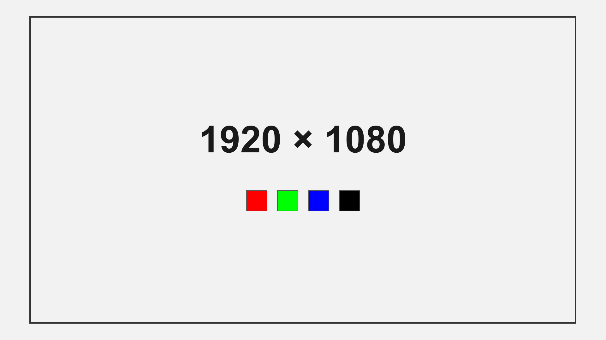
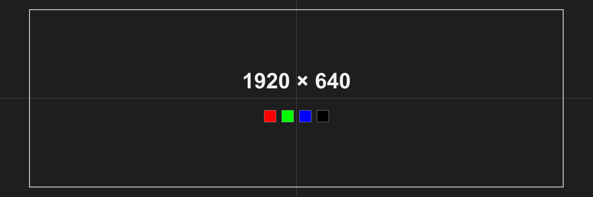
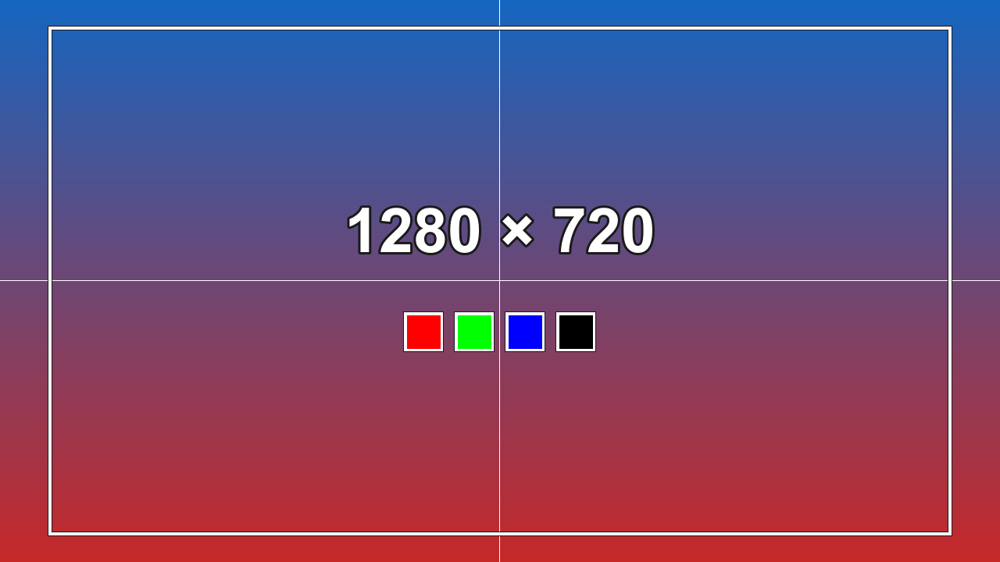
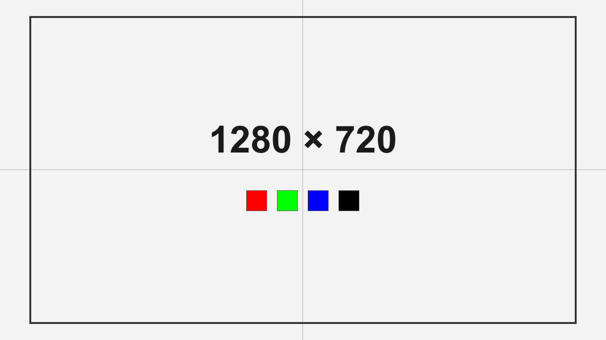

# Frontend Asset Test Kit

[](https://github.com/kiraTheresa/Frontend-Asset-Test-Kit/actions/workflows/ci.yml)
[]()
[](LICENSE)

前端通用测试素材包：由脚本参数化生成的标准化测试图片。

所有素材均由程序精确绘制（Node.js + SVG + sharp 栲格化），**不使用任何 AI 图像生成**。

## 效果预览

**在线 Gallery**：生成素材后运行 `npm run gallery`，浏览器打开 `gallery/index.html`；线上预览见 [Gallery 链接](#)（部署后回填）。

每张素材自带尺寸标注、RGB + 黑色四色测试块、边框与中心十字线——任何拉伸、裁切、偏移都能一眼看出：

<p align="center">
  
  
</p>
<p align="center">
  
  
</p>

## 用途

- 前端页面开发 / UI / CSS / Canvas / WebGL 测试
- 图片容器测试：`object-fit`、`background-size`（cover / contain）等
- 响应式布局测试、视频录制中的网页背景与占位素材
- **把"图片有没有被正确显示"变成肉眼一眼就能判断的事情**：任何拉伸、裁切、偏移、错误缩放都能立刻被发现

## 快速开始

```bash
npm install
npm run generate   # 生成全部素材（default + dark + colorful 三个主题，共 144 张 PNG）
npm run verify     # 验收：逐张检查尺寸、格式、背景、边框、十字线、文字、方块
npm run gallery    # 构建 gallery/index.html 素材预览页（直引 output 原图）
```

### 生成器选项

```bash
node generator/index.js [选项]

  --theme <name>     主题: default | dark | colorful | all（默认 all，支持逗号分隔多个）
  --category <list>  类别: 逗号分隔，如 avatar,icon（默认全部）
  --format <fmt>     输出格式: png | svg | both（默认 png）
  --out <dir>        输出根目录（默认 <kit>/output）
  --seed <n>         colorful 主题随机种子（默认 20260904）
```

例如只重新生成暗色主题的背景图：

```bash
node generator/index.js --theme dark --category background
```

例如换一批 colorful 配色重新生成：

```bash
node generator/index.js --theme colorful --seed 42
```

## 目录结构

```text
├── README.md               本说明
├── package.json
├── config/
│   ├── presets.js          尺寸矩阵（类别 -> 尺寸列表）
│   └── palette.js          colorful 随机配色池
├── generator/              生产工具
│   ├── index.js            生成器入口（CLI）
│   ├── layout.js           参数化视觉模板（SVG 源）
│   ├── themes.js           主题与四色测试块定义
│   ├── variants.js         colorful 变体生成
│   └── verify.js           素材验收脚本（像素级检查）
├── tools/
│   └── build-gallery.mjs   素材 gallery 预览页构建器
├── docs/                   README 示例图
└── output/                 生成结果（generator 是生产工具，output 是生产结果）
    ├── default/            浅色主题
    │   ├── avatar/ background/ banner/ thumbnail/
    │   └── card/ cover/ poster/ icon/ test/
    └── dark/ colorful/     深色 / 随机配色主题（同上结构）
```

## 命名规则（强制）

统一命名：`{category}-{width}x{height}.{format}`

```text
avatar-256x256.png
background-1920x1080.png
banner-1920x640.png
thumbnail-1280x720.png
poster-1080x1920.png
```

文件名即尺寸说明：`1920x1080` 表示 `width=1920, height=1080`（与图片中央文字一致）。

## 每张素材的视觉模板

无论什么类别、尺寸、比例、主题，都遵循同一套参数化模板：

| 元素 | 说明 | 用途 |
| --- | --- | --- |
| 中央尺寸文字 | 实际像素值，如 `1920 × 1080` | 直接读出原始尺寸，判断是否按原始比例正确显示 |
| RGB + Black 四个方块 | `#FF0000` `#00FF00` `#0000FF` `#000000`，严格 1:1 正方形 | 非等比拉伸时正方形会变成矩形，一眼即可发现；RGB 同时可观察色彩渲染 |
| Padding | 距图片边缘约 5%（宽 / 高各自计算） | 图片被裁切 / cover / 拉伸时，安全区域的变化非常明显 |
| 内侧边框 | padding 内侧一圈矩形边框 | 明确的内容边界，裁切、变形、错误 object-fit 一眼可见 |
| 中心十字辅助线 | 极细、低不透明度的水平 / 垂直线 | 判断图片 / 容器是否居中、是否偏移、background-position 是否正确 |

补充说明：

- **四色测试块的颜色在任何主题下保持恒定**，保证跨主题具有一致的测试标准；方块带一圈极细的主题色描边，仅用于在深色背景上定位黑色方块，不影响方块内部的测试颜色。
- **短边过小的素材会自动省略放不下的元素**（如 64x64 省略文字、32x32 同时省略方块），阈值定义在 `generator/layout.js`。
- 布局全部按比例参数化（padding 5%、字号短边 11%、方块短边 6% 等），因此 `640x360` 与 `3840x2160` 的视觉结构完全一致。

## 主题

| 主题 | 背景 | 文字 / 边框 | 适用 |
| --- | --- | --- | --- |
| `default` | 浅灰 `#F2F2F2` | 深色 | 常规网页开发 |
| `dark` | 深灰 `#1E1E1E` | 浅色 | 暗色 UI |

## 尺寸矩阵

### avatar（1:1）

`64x64` `128x128` `256x256` `512x512` `1024x1024`

### background（16:9 / 21:9 / 16:10 / 4:3 / 9:16）

`1920x1080` `2560x1440` `3840x2160` `2560x1080` `1920x1200` `1024x768` `1080x1920` `1440x2560`

### banner（16:9 / 21:9 / 5:2 / 3:1 / 4:1）

`1920x1080` `2560x1080` `1920x768` `1920x640` `1920x480` `2560x720`

### thumbnail（16:9 / 4:3 / 3:2 / 1:1）

`640x360` `1280x720` `640x480` `720x480` `512x512`

### card（1:1 / 4:3 / 3:2 / 16:9 / 3:4）

`512x512` `640x480` `720x480` `1280x720` `480x640`

### cover（OG / 16:9 / 3:4）

`1200x630` `1920x1080` `1080x1440`

### poster（2:3 / 3:4 / 9:16）

`1080x1620` `1080x1440` `1080x1920`

### icon

`32x32` `64x64` `128x128` `256x256`

### test（纯比例基准）

`512x512`（1:1）`640x480`（4:3）`720x480`（3:2）`1280x720`（16:9）`640x400`（16:10）`672x288`（21:9）`360x640`（9:16）`480x640`（3:4）`480x720`（2:3）

## 如何扩展

| 需求 | 做法 |
| --- | --- |
| 新增一个尺寸 | 在 `config/presets.js` 对应类别数组中追加 `[width, height]`，重新 `npm run generate` |
| 新增一个类别 | 在 `config/presets.js` 中新增一个键（自动生成对应目录与命名） |
| 新增一个固定主题 | 在 `generator/themes.js` 的 `THEMES` 中新增配色，重新生成 |
| 调整 colorful 色彩风格 | 修改 `config/palette.js` 的颜色池 / 渐变比例，重新生成 |
| 换一整套 colorful 配色 | `node generator/index.js --theme colorful --seed <新种子>` |
| 调整模板布局（padding、字号、方块大小等） | 修改 `generator/layout.js` 顶部的比例常量 |

修改后建议运行 `npm run verify` 做像素级回归验收（尺寸、背景色、边框、文字渲染、四色方块位置与颜色）。

## 技术实现

- **SVG 是唯一生成源**：`generator/layout.js` 负责把参数（尺寸 × 主题）渲染成 SVG 源，`sharp` 将其栅格化为 PNG（需要 SVG 源文件时可 `--format svg` 或 `--format both`）。
- 全部坐标由 `computeMetrics()` 统一计算，绘制与验收共用同一套坐标，保证一致性。
- 不依赖任何 AI 图像生成；素材可随时通过修改配置后重新生成，而不是手工维护图片文件。
